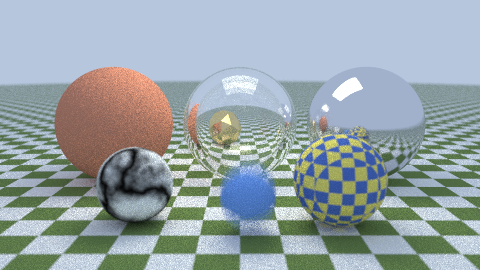
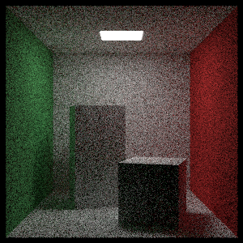

# raytrace

A path tracer in sysl, in the scope of Peter Shirley's *Ray Tracing in One Weekend* and *Ray Tracing:
The Next Week*.



- **Shapes:** spheres (moving ones too, for motion blur), parallelograms, triangles (Möller–Trumbore)
  and triangle meshes from a small OBJ reader (`obj.sysl`), plus translated and rotated instances.
- **Materials**, each a trait object: Lambertian, metal with fuzz, dielectric (Snell's law, Schlick's
  reflectance, total internal reflection) and diffuse lights.
- **Textures:** solid, a 3D checker, Perlin marble (turbulence), and images read with
  [`png`](https://github.com/sysl-lang/png).
- A positionable thin-lens camera with defocus blur.
- A BVH split along the longest axis.
- Paths end at a maximum depth, or optionally earlier by Russian roulette (`--roulette`).
- **Deterministic:** every sample has its own PCG32 stream (`sysl.rand`), keyed by its pixel and its
  number, so the image is bit-identical across runs and across thread counts.
- Rows are rendered on a pool of `sysl.threads` workers that take rows from an atomic counter.
- Output is PNG (encoded by [`cairo`](https://github.com/sysl-lang/cairo)) or binary PPM.

```
sysl run . -- showcase -w 480 -h 270 -s 128 -o showcase.png
sysl run . -- cornell -w 300 -h 300 -s 256 -o cornell.png
sysl run . -- showcase -w 1600 -h 900 --rays        primary-ray throughput, one thread
```

Options: `-w`/`-h` set the size, `-s` the samples per pixel, `-d` the longest path, `-t` the number of
threads (by default, every core), and `-o` the file (`.ppm` for a PPM, anything else for a PNG).



It needs cairo (`brew install cairo`) for the PNG encoder.

## Tests

`sysl test .` runs 46 tests. Each one checks against something the tracer did not compute itself.

- **Intersections against closed form:**
  - a sphere hit head-on, off-axis (`5 − √(1 − 0.36)`), from inside, and missed;
  - a moving sphere at two instants;
  - `(u, v)` at the poles and meridians;
  - a triangle's barycentric coordinates, and a slanted ray onto `x + y + z = 1`;
  - a quad's edge fractions on its front and back faces;
  - the slab test, including parallel rays and the interval's end.
- **Optics:**
  - refraction at 45° into glass against Snell's law (the values are numpy's);
  - normal incidence;
  - Schlick's formula at 0°, at grazing incidence and at `cos = ½`;
  - total internal reflection past the critical angle;
  - metal absorbing below the surface;
  - emission.
- **White furnace:**
  - lossless Lambertian, metal and glass surfaces in a uniform white sky must come out exactly white (to 1e-6, at 200 bounces);
  - the same scene with Russian roulette must converge to white, which shows it is unbiased;
  - with paths cut at two bounces, energy must go missing.
- **BVH against brute force:** 20,000 random rays through 320 random spheres, triangles and quads must
  give a bit-identical nearest hit from the BVH and from a linear list.
- **Threads:** the showcase must be bit-identical at 1, 3 and 8 threads, and a different seed must give
  a different image.
- **The final image:**
  - the showcase at 160×90, 16 spp, must match the committed `assets/reference.png` with a PSNR above 40 dB;
  - each channel's mean and standard deviation must be within 0.5 of the values numpy measured from that PNG.
- **Formats:**
  - PPM and PNG must round-trip byte for byte (PNG is written by cairo and read back by `sh.sysl.png`);
  - the PPM header parser must accept comments and refuse what it cannot read;
  - the gamma encoding is checked.
- **Error paths:** an OBJ with a bad number, a missing vertex, index 0, or a face with two corners must be
  refused at the right line, and an empty image texture or an unknown scene name must be handled.

## Against C

`bench/rt.c` ports the showcase to C, step for step: the same PCG32 streams, the same order of random
draws, the same BVH, and the materials behind function-pointer tables. **Its image is byte-identical to
the sysl one** (400×225 at 32 spp, MSE 0). That makes the C port a second, independent check on the
whole renderer.

```
cc -O2 -o rt-c bench/rt.c -lm && ./rt-c 400 225 32
```

Measured on an M-series Mac, single-threaded, with the sysl program built at `optimization = "2"`:

| | C -O2 | sysl | ratio |
|---|---|---|---|
| showcase 400×225, 32 spp | 629 ms | 1476 ms | 2.3× |
| primary rays, 1600×900 | 23.5 Mrays/s | 7.7 Mrays/s | 3.0× |

Thread scaling, 400×225 at 32 spp:

| threads | 1 | 2 | 4 | 8 | 16 |
|---|---|---|---|---|---|
| ms | 1475 | 1335 | 1128 | 1100 | 1041 |

**The speed gap is the compiler's.** Both causes have been reported for sysl `0.1.0-alpha.13`:

1. **Thread scaling.** `Hit` carries its material as a `&sync Material`. Each copy of the
   `Option[Hit]` that the BVH passes up retains and releases that material with an atomic add, which
   is 13 `ldadd`s in `BvhNode.hit`. Every thread then fights over the same few counts. A reduced
   program runs 4× slower on two threads than on one.
2. **Single-threaded speed.** `Ray`, `Aabb` and `Option[Hit]` are passed and returned through
   memory, and `Aabb.hit` is not inlined into `BvhNode.hit`. The C port passes pointers and has its
   box test inlined.

## What it cannot do yet, and why

- **An image texture cannot be put in a scene**, so the showcase has a checkered ball where the
  planet would be. The scene is shared between the render threads, so it is built from `&sync`
  objects. A `&sync` object may not hold a slice or a `Buf`, because neither has an atomic count. That
  leaves no way to say "pixels decoded once and then read by every thread", short of a lock on every
  texel or a raw pointer. `ImageTexture` itself works and is tested; only sharing it is blocked.
- **There is no list of hittables in a scene**, for the same reason. The BVH is a tree of `&sync`
  nodes, so it does not need one. `HitList` exists for the brute-force test, which runs on one thread.

## Where it came from

The algorithms, the scene layout and the Cornell box are Shirley's (*Ray Tracing in One Weekend* and
*The Next Week*, v4). `assets/planet.png` and `assets/icosphere.obj` are generated by a short Python
script.

## License

ISC — see `LICENSE`.
